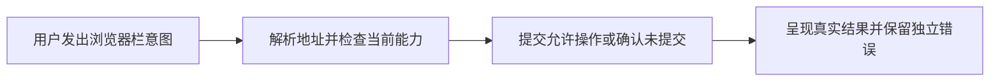
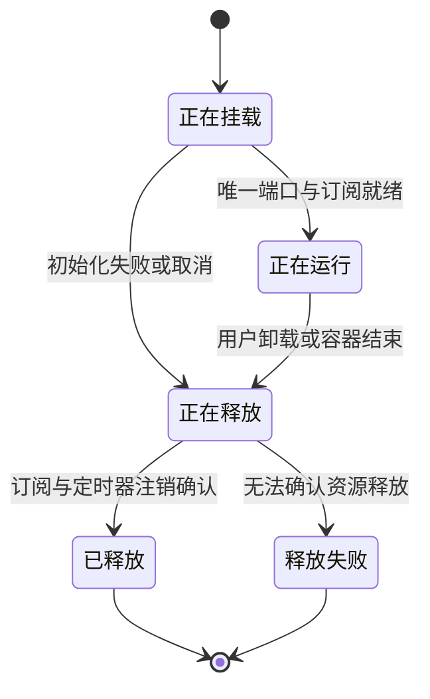

# M1 浏览器栏请求与界面生命周期补链

状态：DESIGN_REVIEW_READY。绑定UI r3拒收候选66be416ae6e54f2425f5496b58ef8c1181480ecd及独立审查m1-w4-browser-chrome-20261003-r3的三项P1；本文件只补本次chrome边界，不改变远端browser wire/导航owner，不证明代码已修复。

## 地址歧义的明确规则

字符串`名字:数字/路径`同时可能是单标签host:port和opaque URI，单凭该字符串不能无歧义恢复用户意图。M1地址栏采用确定规则，不靠DNS、网络成功、调试日志或hostname特判猜测：

1. 标准显式scheme `http`、`https`、`about`、`blob`、`data`、`file`、`javascript`、`mailto`、`tel`、`sms`、`geo`、`urn`、`ftp`、`ftps`、`ws`、`wss`不区分大小写，原值透传。透传不表示远端支持对应handler；Host仍按现有能力显式成功或失败。
2. 具有`://`分隔符或scheme名中有`+`的自定义URI保留；非数字opaque payload的scheme也保留。仅`-`/`.`不足以表明显式scheme，它们也出现在合法hostname中。原始大小写/路径/query不改写。
3. 其余匹配单标签/域名/IP加数字port的地址按无scheme网络地址处理，加`https://`，包括`intranet:8080/path`、`localhost:8080`、`example.org:8080/path?q=1`。
4. 未注册的单标签或含`-`/`.`自定义scheme加数字payload与规则3发生语法歧义时，默认host:port；要明确自定义scheme意图使用显式`://`，例如`custom://123/path`、`custom-with-dash://123/path`、`custom.with.dots://123/path`。这是地址栏解析策略，不是任意URI都可无损识别的承诺；不得把同一字符串同时承诺为host和opaque URI。地址栏标准URI与已声明自定义语法仍保留，不为了一个hostname增加特判。

上述规则替换r3“所有explicit scheme都可与无scheme数字hostport自动区分”的不成立承诺。验收必须走真实地址栏Enter验证下表，原source既有localhost/IP/http/https/query矩阵仍保留；只测custom+scheme不能证明tel。地址栏composition确认不navigate，明确Enter才发送一次。

| 输入 | 唯一预期navigate.url |
| --- | --- |
| `intranet:8080/path` | `https://intranet:8080/path` |
| `example.org:8080/path?q=1` | `https://example.org:8080/path?q=1` |
| `my-host:8080/path` | `https://my-host:8080/path` |
| `tel:123456` / `TEL:123456` | 各自原值 |
| `geo:37,122` / `data:123` | 各自原值 |
| `custom+scheme:123/path` / `custom://123/path` | 各自原值 |
| `custom-with-dash://123/path` / `custom.with.dots://123/path` | 各自原值 |
| `custom:123/path` | `https://custom:123/path` |
| `custom-with-dash:123/path` | `https://custom-with-dash:123/path` |
| `custom.with.dots:123/path` | `https://custom.with.dots:123/path` |
| `custom:value` | `custom:value` |

## 请求、结果与错误唯一owner

Chrome只拥有本地地址输入及独立的commandProblem/statusProblem投影；远端授权、导航、tabs和profile仍由Host/connection权威提供。UI capability/epoch是typed snapshot，发送前tab status检查失败/撤销返回“未提交”结果，不能制造命令成功或清除上一个command rejection。commandProblem只由实际命令成功结果清除或实际失败结果替换；健康poll、预检查、未发送操作、drawer变化均不清它。statusProblem只由status观测结果管理。错误展示顺序不得让短暂status错误永久隐藏已有command拒绝，status恢复后原拒绝仍可见。

新增组合黑盒：先reload被拒绝形成可见COMMAND_REJECTED，再点击tab；发送前分别撤销control、删除epoch、撤销tabs capability、status抛错。全部断言tab零命令且原拒绝在健康poll后仍可见，最后一个真正成功的命令才清除。原r3独立错误/epoch/地址证据仅在未受影响输入仍成立时复用。

## 项目图与状态机

复用已有m1-navigation作为UI→Host→Engine导航业务图；另外两个不同对象流补齐chrome本地请求及Cordis实例资源，不把每条操作都等同卸载：

- `docs/dagpipe/graphs/m1-chrome-request.graph.json`：一个浏览器栏意图→确定地址与当前能力→实际提交或typed未提交结果→呈现结果。NativePort是公开消费边界；Host拒绝保留原error chain。成功/拒绝/预检查失败/取消在唯一结果ARC表达。
- `docs/dagpipe/graphs/m1-chrome-lifecycle.graph.json`：一个界面实例生命周期→唯一端口与订阅→内部运行直到卸载→释放订阅/定时器→释放结果。内部可处理任意请求/poll/drawer，不回写独立Host真源；失败/取消仍释放已创建资源。实例结束不销毁Host session/profile。

| 节点/对象 | 唯一owner与实际source | 验证终点 |
| --- | --- | --- |
| 地址/当前能力/命令请求 | ui-plugins/main.tsx；消费client-domain的typed port，不复制协议 | Enter实际URL、预检查失败零命令、composition不提前navigate |
| 端口提交与typed结果 | ui-kernel/kernel.ts及既有NativePort；本修复不新增该实现 | 命令拒绝/error显式、成功后正确清除对应command问题 |
| 独立错误投影 | ui-plugins/main.tsx的command/status各自owner | rejection→tab撤销/status失败组合黑盒及健康poll后结果 |
| 生命周期资源 | 既有Cordis kernel和UI effect清理owner | dispose/reload公开consumer，subscription只有一份，unmount后计时器/监听无残留 |
| 作者测试资源 | 独占public consumer服务器/browser/tmp的作者 | 明确PID停止、TaskSpace结束、归档证据、tmp移除；不代替产品session生命周期 |

图通过`dagpipe graph validate`后还需独立本增量设计PASS才派r4产品返工。r4从fresh AB origin/main新worktree选择性承接已验证source，复制这些精确graph和本合同到候选并绑定hash/validation结果；图的设计归属与实际source映射要让reviewer能从候选恢复。仅改r3三P1涉及的UI及真实consumer测试，保留原生/Host/connection独占边界。代码开发/公开consumer黑盒完成后再审新candidate；最终系统IME、安装版BB和M1仍后续验收。
